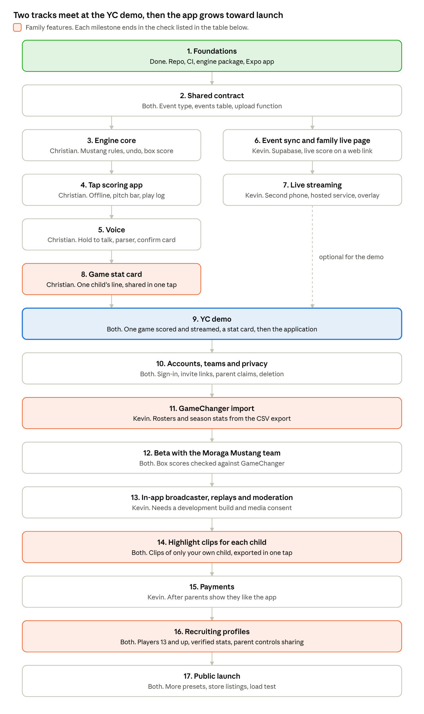

# Youth baseball and softball scoring app: engineering plan

Last updated October 23, 2026. Christian Alcala.

Sandlot is a GameChanger competitor for baseball and softball that wins on scoring. A parent scores by voice or one tap, fixes any mistake in one step, and keeps scoring with no signal, while family follow the score and the video live. After every game, each registered family gets a stat card and highlight clips of their own child. Because every scored play records who took part and when, each play can become a clip, a top play in the league's feed, and over the years a verified record that recruiters trust. Scoring brings teams in, and highlights and recruiting are built on top of it. This plan orders the work by dependency, not by date. Christian and Kevin build two tracks side by side, which meet at the YC demo and then grow into the beta and the public launch.

## Team and ownership

Two people build Sandlot, each directing their own coding agents. Each person owns separate directories, so their agents rarely touch the same files.

| Person | Owns | Directories |
| --- | --- | --- |
| Christian, with Claude Code and Codex | Rules engine, tap scoring app, voice, stat cards | `packages/engine`, `packages/voice`, `apps/mobile` |
| Kevin, with Claude Code and Codex | Supabase backend, event sync, the family live page, live streaming, highlight clips, GameChanger import | `supabase/`, `apps/web` |

- **Shared contract.** How plays move from the phone to the server and the live page, written in [contract.md](contract.md). Both people signed off on it, and both sign off on any later change.
- **Root files.** Only one person at a time changes root config or `pnpm-lock.yaml`.
- **Agents.** Both people use Claude Code and Codex for now. In each person's track, Claude Code orchestrates and writes most of the code, and Codex takes tasks Claude Code hands it. Every agent reads `AGENTS.md`, works in its own git worktree, and opens PRs. Only people merge.

## Goal

A team switches only when scoring gets clearly easier for the scorekeeper and the families following along lose nothing. So the first version matches GameChanger on what families see and beats it on what the scorekeeper does.

| Capability | First version | Later |
| --- | --- | --- |
| Pitch-by-pitch scoring, baseball and softball | Taps for pitches, voice or taps for plays | |
| Fixing mistakes | Undo, spoken fixes, and a play log that previews what a fix changes | Parents flag a play they think is wrong |
| Scoring with no signal | A whole game offline, synced afterward | |
| Live score and play-by-play for family | A private web link, with no app to install | Public game pages |
| Live video | A second phone streams through a hosted service, shown on the family live page | Our own in-app broadcaster and replays |
| Stat card for each kid | After every game, shareable in one tap | |
| Highlight clips of your own kid | One clip in the YC demo | Automatic clips of each of your child's plays, exported in one tap |
| Top-plays feed | | A league's top plays of the day, week and month, ranked by game situation and family reactions |
| GameChanger import | | Rosters and season stats, before the beta |
| Recruiting profile | | For players 13 and up, built from verified stats |
| Scout access | | Verified college, pro and sponsor scouts see profiles that parents of players 13 and up opt in to share |
| Box scores and season stats | Yes | Spray charts, more stats |
| Pitch-count report for the league | Yes | |
| Roster, lineups, handing scoring to another parent | Yes | |
| Team schedule | Yes | |
| Team messaging | Not planned | |
| Paid tier | Not in the first version | After parents show they like the app. See Pricing. |

GameChanger has no public API, so nothing can be written into it ([Dugout](https://www.getdugout.com/gamechanger-api), [gcstats](https://gcstats.app/gamechanger-api/)). A team's official stats live in whichever app it scores in. GameChanger is Little League's official partner, so the first customers are teams not tied to it, like travel teams, PONY leagues and rec leagues. The Moraga beta runs alongside GameChanger and stays unofficial.

GameChanger's scoring is free. It charges the families who follow a game: Plus, at $9.99 a month or $39.99 a year, is for live games and live updates. Premium, at $14.99 a month or $99.99 a year, adds season archives and post-game insights. Family, at $24.99 a month or $179.99 a year, covers 4 accounts. Sandlot gives the live score, play-by-play and stat card away free.

## Architecture at a glance


Only the scorer's phone writes events. The server runs the same engine on every event, and the family live page only reads the result. Video goes from a filming phone through the streaming service, never through Supabase.

## Data model

A game is an append-only list of events, and the current game is that list replayed through the engine. Every other part of the app, from the diamond on screen to the box score, reads that one shape. The full types live in `packages/engine/src/types.ts`.

```ts
type Sport = 'baseball' | 'fastpitch' | 'slowpitch';

type Command =
  | { kind: 'pitch'; result: 'ball' | 'called_strike' | 'swinging_strike' | 'foul' | 'foul_tip' | 'hit_by_pitch' | 'in_play' }
  | { kind: 'ball_in_play'; outcome: Outcome; trajectory?: Trajectory; fielders: Position[]; advances: Advance[] }
  | { kind: 'runner'; event: RunnerEvent; runner: PlayerRef; to: Base | 'out' }
  | { kind: 'substitution'; change: Substitution }
  | { kind: 'game'; event: GameControl }
  | { kind: 'undo'; target: GroupId }
  | { kind: 'correct'; target: GroupId; replacement: Command[] };

type Event = {
  id: EventId;        // made on the phone, so resending is harmless
  gameId: GameId;
  seq: number;        // order within the game
  group: GroupId;     // one voice press or one tap action
  lockEpoch: number;  // which scorer session wrote it
  source: 'tap' | 'voice';
  at: Timestamp;      // when the scorer started the action
  command: Command;
};

type RuleSet = { sport: Sport; innings: number; fielders: 9 | 10; /* every rule is a setting */ };

type GameState = {
  inning: number; half: 'top' | 'bottom'; outs: 0 | 1 | 2;
  count: { balls: number; strikes: number };
  bases: { 1?: Runner; 2?: Runner; 3?: Runner };
  score: { home: number; away: number };
  lineups: Lineups; defense: Defense; pitchCounts: Record<PlayerId, number>; alerts: Alert[];
};
```

- Events are never edited or deleted. Undo and fixes are new events that target a group, so one undo reverses everything one press recorded. Answering a voice "Not sure" card is a tap, so it records its own play ([ADR 0006](adr/0006-a-press-saves-its-clear-calls-and-asks-about-the-rest.md)).
- Game state is always computed from the events. The stored copy on the server is a cache that can be rebuilt.
- Events and stats refer to players by ID. Names live in one table, which keeps privacy rules in one place.
- IDs are branded types, so an event ID can never be passed where a group ID belongs.
- The engine lists the players in every play and their roles: batter, pitcher, fielders, runners. Stat cards and highlight clips both read that list to find one child's plays.
- Imported stats are their own record type, never events. A GameChanger export has stat lines, not plays, so imported lines add to season totals but can't be replayed or corrected.
- Sport is part of the rule set from day one. Adding softball later, after these types are fixed, would mean rewriting the engine.

## Rules engine

The engine is the critical path. Voice, stats, corrections and the family view all depend on it being right. It is pure TypeScript with no network, clock or randomness, so the same events always give the same game, on the phone and on the server.

| Function | What it does |
| --- | --- |
| `apply`, `applyGroup` | Accept or reject one command, or a whole play, all or nothing |
| `replay` | Build the game from its events |
| `candidates` | List every legal reading of an unclear play, such as "runner scores" with two runners on |
| `classify` | Decide whether a play saves instantly, needs a confirm, or needs a hit-or-error call |
| `explain` | Say a play in plain words for the read-back banner |
| `previewCorrection` | Show what a fix changes: score, stats, and later plays it changes or breaks |
| `missedPlayCandidates` | Suggest the missed play that would make a rejected play legal |
| `stats` | Box score and pitching lines from the replayed game |
| `participants` | The players in a play and their roles, for stat cards and highlight clips |

**Baseball and softball.** Each league's rules are a rule set, which is data. A preset like Little League Minors is a published rule set, and a local league's rules are a preset plus overrides. The September plan's settings already cover innings, fielders, batting order, walks, stealing, leadoffs, dropped third strikes, run limits, mercy rules and pitch counts. Softball adds settings, such as slowpitch rules that start the count at one ball and one strike or call the batter out on a foul with two strikes. Check each against the league's rule book before writing the fixture.

**Presets ship only when a real team can prove them.** The beta team plays in Moraga's Mustang division, which follows PONY rules with local changes. So Mustang with Moraga's rules comes first, then Pinto. Softball presets ship when a softball team joins the beta.

**Testing.**

- Fixtures written first. Each is a YAML file with a starting state, commands, the expected result, and a citation to the rule book.
- Property tests. Outs stay between 0 and 2, no base holds two runners, replaying equals applying one by one, and undo restores the prior state.
- Real games. Paper scorebooks and beta games are entered as event lists, and the engine's box score must match exactly.

### Moraga rules

The first presets are Moraga's Mustang and Pinto divisions, which use PONY rules with local changes ([Moraga PONY rules](https://www.moragabaseball.org/pony-rules/), Mustang revised February 2024, Pinto revised April 2025). Settings marked new are ones the September plan didn't have.

| Rule | Mustang, ages 9 and 10 | Pinto, ages 7 and 8 | Engine setting |
| --- | --- | --- | --- |
| Pitcher | Kids pitch | Coaches pitch to their own team | Pitch source |
| Fielders | 9 | 10, with a roving outfielder | Fielders |
| Time limit | 6 innings, but no new inning after 2 hours from the umpire's start time. If tied, one extra inning, then a tie. | Same, except a tie after 6 innings can go up to 3 more innings inside the 2 hours | Time limit. New: tie rules. |
| Called game | Complete after 4 innings, or 3 and a fraction if the home team leads | Not stated | New: length of a complete game |
| Run limit | None | 5 runs in each of innings 1 to 5 | Run limit with a late-inning exception |
| Pitches per batter | No limit | 6. The batter is out after the 6th unless it's fouled off. | Max pitches per batter |
| Strikeouts | Called or swinging. The catcher doesn't need to catch the third strike. | Swinging only | Dropped third strike off. New: called strikes off. |
| Walks and hit batters | Walks allowed. Hit batters follow the PONY rule book. | None | Walks and hit-by-pitch |
| Stealing | First half: only after the ball crosses the plate, no leadoffs. Second half: leadoffs and steals if most coaches agreed. | None. A runner leaving early gets one team warning, then is out. | Stealing and leadoffs, pinned per game. New: out for leaving early. |
| Bunting | Not allowed | Not allowed | New: the engine rejects bunts |
| Infield fly and balks | Neither | No infield fly | Off |
| Batting order | Everyone present bats. A late arrival joins at the end. | Everyone present bats. Batting out of order costs one out, and plays from the wrong batter on are wiped out. | Continuous order. New: a late-arrival command and an out-of-order penalty. |
| Pitching limits | Pitch Smart counts for ages 9 and 10. At most 6 outs a day in the first half and 9 in the second, across every game that day. A removed pitcher can't pitch again that game. | None | Pitch-count table. New: an outs-per-day limit and no pitcher re-entry. |
| Playing time | Every player plays 4 defensive innings | Players sit out in rotation when one team has more players | New: playing-time alerts |
| Thrown bat | Out on the second time | Out on the second time, scored like a strikeout with no runners advancing | New: batter out by rule |
| Official scorer and reporting | The home team's scorekeeper is the official scorer. Teams report scores and pitch counts to the commissioner. | Not stated | A pitch-count report from the app |

- The engine never reads a clock. It times the 2-hour limit from the umpire's start time, which the scorer enters, and from the timestamps on events.
- The outs-per-day limit spans games. The app adds up a pitcher's outs from earlier games that day and passes them into the new game's setup.
- The rules change halfway through the Mustang season. Each game pins its own rule set, so first-half games keep replaying under first-half rules.
- Pinto's dead-ball rule at the pitcher's circle needs no engine logic. The scorer records where the runners end up.
- Pinto's out-of-order penalty wipes out later plays. That is a correction like any other: one event that removes the wrong batter's plays and adds the out.

## Phone app and offline scoring

The scorer's phone is the source of truth during a game, so scoring never waits on the network. The app is Expo with TypeScript, and it keeps the game in SQLite on the phone.

- **Saving a play.** The engine accepts the command, one SQLite transaction writes the event and queues it for upload, then the screen updates. Nothing waits on the network.
- **One scorer at a time.** A game has one scorer lock. Only the lock holder writes events, so two phones never need their edits merged. Taking the lock needs signal. Keeping it does not.
- **Handing off.** The scorer hands the lock to another parent while online with nothing left to upload. An admin can force a takeover, and late events from the old phone come back as items to review.
- **Sync.** The phone uploads queued events when signal returns, when the app opens, every few seconds during a live game, and before the game is finalized. Each event has its own ID, so a retry never duplicates a play.
- **The screen.** The diamond, count, score and play log all come from the replayed game. Pitches are one tap on a bar that is always visible. A play is one tap on the outcome, or one voice press.
- **Corrections.** Undo is instant. Every other fix opens a preview of what it changes before it saves. The voice spec from September defines these flows, and it carries over.

The September plan wanted SQLite encryption on the phone because it holds kids' names. Confirm Expo supports it before relying on it.

## Voice scoring

Voice is the main reason a team would switch, and also the biggest unknown, so a throwaway prototype tests it before the app depends on it. The rule from September stays: the AI proposes a play, and only the engine decides whether it is legal.

1. The scorer taps or holds the mic button. The mic stays warm on the scoring screen and keeps the second before the touch, so no words are lost ([ADR 0005](adr/0005-the-mic-stays-warm-on-the-scoring-screen.md)).
2. Speech goes to a transcription service. September's plan chose OpenAI's gpt-live-transcribe, and the prototype confirms that choice or replaces it.
3. A small parser on the phone handles common phrases like "ball", "steals second" or "fly out to center" with no AI. Anything else goes to an AI parser, which returns candidate commands.
4. The engine checks the commands and classifies the play. A simple legal play saves instantly, with a spoken-word banner and undo. An unclear, complex or misheard play shows a confirm card or buttons. When a press holds several calls and one isn't clear, the clear calls before it save, and only the rest gets a card ([ADR 0006](adr/0006-a-press-saves-its-clear-calls-and-asks-about-the-rest.md)).
5. Any failure falls back to tap scoring in one step.

Voice can record pitches too, so a parent can say "ball, strike" the way they would out loud. That costs more than September's estimate of about 4 cents a game, which assumed taps for pitches. The targets are under 25 cents for a game with plays by voice and pitches by tap, and under 40 cents when every pitch is said ([#78](https://github.com/sandlot-app/sandlot-app/issues/78)).

**What the prototype must prove.** Record 100 or more spoken plays over game video with crowd noise playing. Voice goes ahead only if all of these hold:

- [ ] At least 95% of plays parse exactly right
- [ ] No wrong play would have saved without a confirm
- [ ] 90% of simple plays show a result within 1.5 seconds of release
- [ ] 90% of complex plays show a result within 2.5 seconds
- [ ] Measured cost per game is under 25 cents

The prototype is thrown away. Its recorded test set and the on-phone phrase parser carry into the real app. September's voice edge-case spec carries over unchanged, apart from deferring parent flags.

The first version streams the press for live transcription, so words show while the scorer speaks, as the Figma screens do. When streaming can't connect, the phone uploads the recorded clip instead (spec A4, A5). The contract's Voice section has both endpoints.

## Family features

Every game gives each family something about their own child: a stat card, highlight clips, and over time a recruiting profile. This is what gets families to register, and it is something they notice every game.

- **Who sees what.** Cards, clips and profiles are only for registered families who have claimed their child. The server checks the claim before it shows or exports anything. No family ever gets another child's card or clip.
- **Game stat card.** After each game, the app makes a card with the child's line, like "2 for 3, a double, 2 RBI", styled to share the way Strava shares a run. The engine computes the line from the replayed game. The card shows only stats the division uses, so a Pinto card has no walks or pitching. A parent exports it as an image in one tap.
- **Highlight clips.** Each event records when the scorer started the action and who took part. With the recording's clock offset, the server cuts a short clip around each play the child was in: a hit, a catch, a throw, a strikeout. The play happens before the scorer taps or speaks, so a clip starts about 10 to 15 seconds before the event's time. Clips come from game recordings, so they need streaming with recording and media consent. For the YC demo, someone claps on camera at the first pitch and the offset is entered by hand. Matching the clocks automatically is still to be designed.
- **Top-plays feed.** A league's top plays of the day, week and month. Plays are ranked first by engine data: the play type and the game situation, such as a walk-off, a home run, a double play or a strikeout with the bases loaded. Reactions from registered families then reorder the list. No machine learning is needed to rank.
- **Who can appear where.** Under 13, clips stay private to the child's family, and the feed is a team or league feed seen only by registered families there. At 13 and up, a parent can publish a clip to a public feed, but only when every player on the field has media consent.
- **Scout access.** Verified scouts from colleges, pro teams and sponsors see only the profiles of players 13 and up whose parents opted in. Profiles show no contact details, and a scout's request for contact goes to the parent. Never for players under 13. An attorney reviews this, and NCAA rules on when colleges may contact recruits are checked, before it ships.
- **Vision models.** After the beta, vision models trim each clip to the pitch and the end of the play, drop clips where the play is off camera, and frame clips for vertical video. They never decide what happened in a play. The scorer's events do.
- **GameChanger import.** GameChanger exports only CSV and PDF files ([Dugout](https://www.getdugout.com/gamechanger-api)), with rosters and season stat lines but no plays. Sandlot imports the rosters and stat lines, marks them imported, and adds them to season totals. A team switching mid-season keeps its history.
- **Recruiting profile.** For players 13 and up. It shows stats scored in Sandlot as verified, separate from imported ones. A parent manages it, chooses who can see it, and shares a link. Accounts stay adults-only, and the profile shows no contact details.

## Pricing

Scoring and following the game are free. Families pay for video and highlights of their own kid, for less than GameChanger charges just to watch.

| Free for good | Paid family tier, after the beta | Later |
| --- | --- | --- |
| Voice and tap scoring, the family live page with score and play-by-play, the stat card after every game | Live video, replays, clips of your own child, the recruiting profile | Verified scout access to profiles parents opt in to share, and sponsors on the league feed |

- Live video costs money for every minute streamed, every viewer and every hour stored. So video is paid, and the price is set only after Kevin's streaming test measures the cost of one streamed game.
- The paid tier is priced below GameChanger's matching plan.
- Scouts and sponsors come after Sandlot holds years of verified stats for players 13 and up. Scouts pay for verified access, never to see children.

## Reliability and observability

After the YC demo, before the beta. The only check before the demo is measuring play-to-page time.

- **One rule for failures.** Every feature has a fallback the user can see, and no failure stops scoring. Voice fails, so tap scoring takes over. Sync stops, so the phone shows "3 plays waiting. Tap to fix." The stream drops, so the live page keeps the score and play-by-play. A clip fails, so the stat card still arrives. The feed fails, and nothing else is affected.
- **Errors.** Crash and error reporting on the phone, the live page and `sync-events`, through one hosted tool such as Sentry, with personal data stripped. Events carry IDs, never names.
- **Sync.** Each `sync-events` call logs the game ID, group ID, error code and time taken, never command contents that could identify a player. A dashboard shows groups per minute, rejects by error code and stuck queues.
- **Live page.** An alert when play-to-page time goes over a few seconds.
- **Voice.** The prototype's five targets become live metrics: parse accuracy, latency and cost per game.
- **Video.** Stream health, and the cost of each streamed game for pricing.
- **Alerts** go to Christian and Kevin, so a Saturday-morning failure is found before a parent reports it.
- Christian reviews what gets logged, since it is a privacy change.

## Server

Supabase stores every event, checks each one again with the same engine, and pushes the live game to family members. It also handles accounts, teams and privacy rules. It keeps September's design for these parts. Video runs through a hosted service for now, and payments wait.

| Part | First version |
| --- | --- |
| Accounts and teams | Profiles, teams, seasons, and roles for admin, scorekeeper, parent and fan. Accounts are adults only. |
| Players | Names live only in the players table. Roster entries hold jersey numbers. Parents claim their child. Opponents are jersey numbers only. |
| Games | The schedule of games with date, time and field, then events, a cached game state, scorer locks, review flags, and per-game stats |
| `sync-events` | Checks the scorer lock and event order, runs the engine, stores accepted events, flags rejected ones, recomputes stats, and broadcasts the new state |
| `voice-session`, `voice-parse` | Checks the lock and the team's monthly voice limit, starts a transcription session, and runs the AI parser |
| Invites and claims | Parents and fans join by invite. A parent claims their child's roster entry. |
| Live view | Supabase Realtime sends each new game state to team members. Messages carry IDs and state, never names. |
| Privacy | Row-level security on every table, with database tests. In-app deletion of a child or an account. Voice transcripts deleted after 30 days. |
| Family live page | A web page in `apps/web` on a private link. It shows the live score and play-by-play from Realtime, and the video when a stream is running. Kevin owns it. |
| Live streaming | A hosted service, Amazon IVS or Mux, takes the stream from a second phone and records it. The live page plays it and draws the score from the game's events. Kevin owns it. |
| Recordings | A `recordings` table holds each game's recording ID, start time and clock offset. The offset can be set after the game starts, unlike the game's fixed `setup`. Kevin owns it. |
| Cards and clips | Checks the family's claim before showing or exporting anything. Cuts clips from game recordings and keeps them as long as the recording. A clip is visible only where its game is, so the public demo game shows its clip and private games don't. Kevin owns clips, and Christian owns cards. |
| Imports | Reads a GameChanger CSV export into rosters and imported stat lines. Kevin owns it. |

The server always wins. If its game state differs from the phone's, the phone takes the server's version and shows "Game re-synced". The table for who sees which name, and public game pages, wait until public pages ship.

## Milestones

Milestones follow dependencies, not dates. Each one ends in a check that has to pass before anything built on it starts. Christian's and Kevin's tracks run side by side and meet at the YC demo.



| # | Milestone | Owner | Includes | Done when |
| --- | --- | --- | --- | --- |
| 1 | Foundations | Christian | Repo, CI, engine package, Expo app | Done. CI passes, and the app runs on an iPhone and the Android emulator. |
| 2 | Shared contract | Both | [contract.md](contract.md): event numbering, upload request, commit checks, errors, live page, demo access | Contract agreed in PR 2. Kevin's backend stores an event the engine produced. |
| 3 | Engine core | Christian | Mustang rules for pitches, walks, strikeouts, balls in play with runner advances, steals, inning changes, score, undo and box score. The interface freezes early so voice and sync can build on it. | Fixtures pass, and one real game replays to the right box score |
| 4 | Tap scoring app | Christian | Lineup setup, diamond, pitch bar, play outcomes, play log, undo, games saved on the phone | A full game scored by tap from video, in airplane mode |
| 5 | Voice | Christian | Hold to talk, streaming transcription with a recorded-clip fallback, AI parser, engine check, confirm card | Meets the five targets in Voice scoring |
| 6 | Event sync and family live page | Kevin | Events uploaded to Supabase, live score on a private web link | A second device sees each play within a few seconds |
| 7 | Live streaming and the demo clip | Kevin | A second phone streams through an existing app to a hosted service, which records it. The live page plays it with the score drawn on top. One clip of one play is cut from the recording using the event's time and an offset entered by hand, and shown on the live page next to the stat card. The demo uses footage that needs no consent. | Video plays on the live page with a correct score overlay, and the clip shows the whole play |
| 8 | Game stat card | Christian | A card of one child's game line, styled for sharing, exported as an image. It shows only the stats the division uses. | After a scored game, the card exports in one tap and matches the box score |
| 9 | YC demo | Both | One recorded game scored and streamed end to end, a stat card with one highlight clip, design mock-ups of the top-plays feed and a scout's view labeled as what comes next, the live page at a public link, at least three real parents trying the app, the demo video, the founder video, the written answers. Details in [demo-plan.md](demo-plan.md). | Application submitted |
| 10 | Accounts, teams and privacy | Both | Sign in with Apple and Google, invite links, parent claims, row-level security, deletion | Database tests pass for every visibility rule, and a parent claims and deletes a test child |
| 11 | GameChanger import | Kevin | Rosters and season stat lines from GameChanger's CSV export, marked imported | A real team's export loads, and its season totals match GameChanger's |
| 12 | Beta with the Moraga Mustang team | Both | Apple developer account, TestFlight, error tracking, sync and latency dashboards, alerts, weekly releases | Six games in a row match GameChanger's box scores, with zero data loss |
| 13 | In-app broadcaster, replays and moderation | Kevin | Development build with a streaming module, recording, media consent, replays, report and stop-stream tools | A full game streamed from the app, with a replay |
| 14 | Highlight clips and the league feed | Both | Clips cut around each of a child's plays, a clip list for each family, one-tap export, the league's top-plays feed ranked by game situation and family reactions, vision models that trim, check and frame clips | After a streamed game, a parent sees clips of only their child and exports one, and the league feed shows only that league's registered families |
| 15 | Payments | Kevin | The paid family tier through the app stores, priced from the measured cost of a streamed game | Sandbox purchases work on both stores |
| 16 | Recruiting profiles and scout access | Both | Profiles for players 13 and up, verified stats kept apart from imported ones, parent-controlled sharing, parent-published clips in a public feed, verified scout accounts, contact requests sent to the parent, PONY Pony and Colt presets, attorney review | A test player's profile shows verified stats, only the people and verified scouts the parent chose can open it, and no player under 13 can be published or scouted |
| 17 | Public launch | Both | Pinto, softball and Little League presets, store listings, load test | Store review approves |

Milestone 7 is required for the demo, because the clip comes from the stream's recording. If the clip isn't ready, the demo shows the stream without it. If streaming isn't ready, the demo shows the live score page without video or the clip, and nothing else changes.

## Changes from the September plan

The architecture stays. What changes is the order of work, so the riskiest parts get tested first and the scoring app is proven before the backend is built around it.

| Area | September plan | This plan | Why |
| --- | --- | --- | --- |
| Engine, event log, scorer lock, AI proposes and engine decides | As designed | Kept | These are the right foundations |
| Voice edge-case spec | Full spec | Kept, with parent flags deferred | It is thorough and still fits |
| Order of work | Backend, privacy and presets before any game is scored, voice after | Engine, tap app and voice first. Accounts and privacy after the YC demo. | Proves the scoring experience first |
| Voice transcription | Streaming from the first version | Streaming first, with a recorded clip as the fallback (changed in October from clip first) | The Figma screens show live words, and the clip path still covers a weak signal |
| Who builds | Codex writes all the code | Christian and Kevin, each with Claude Code and Codex | Two people with separate directories |
| Sports | Baseball presets | Baseball and softball in the rule data from day one. Softball presets ship with a softball beta team. | Adding a sport after the types are fixed means a rewrite |
| Beta presets | Little League Minors and Majors | Moraga Mustang, then Pinto, both PONY | The beta team plays Mustang |
| Live video | Our own broadcaster module before launch | A second phone through a hosted service first. Our own broadcaster after the beta. | No native module or developer account needed for the demo |
| Family view | In the app, for team members | A private web link, with no app to install | Family follow along without installing anything |
| Payments | Before the public launch | After parents show they like the app | Prove the product first |
| Family features | Highlights as bookmarks on a stream | Stat cards, clips of each child, GameChanger import and recruiting profiles | They make families register and set Sandlot apart |
| Schedule | Fixed dates for every milestone | Ordered by dependency, with a check ending each milestone | The plan stays true when dates move |

## Risks and open questions

The biggest risk is voice failing the prototype, because voice is the main reason to switch. Each risk below has a planned response.

| Risk | What happens | Response |
| --- | --- | --- |
| Voice misses its targets | The main reason to switch gets weaker | Ship tap-first, with outcomes in one tap. Keep voice as a beta experiment and retest with the next transcription model. |
| Leagues require GameChanger | Slower adoption | Start with travel teams, PONY leagues and rec leagues. |
| A local rule the engine doesn't know | Wrong box scores | Add a rule setting and a fixture. The beta comparison against GameChanger catches these. |
| Two people's agents editing the same files | Conflicts and broken builds | Separate directories, one owner for root files at a time, and the shared contract agreed before the tracks split |
| Many agent PRs waiting for review | Slow merges | CI must pass, fixtures come first, PRs stay small, and each person reviews the other's work |
| Streaming children without consent | Legal and trust problems | The demo streams footage that needs no consent. Media consent and moderation ship with the in-app broadcaster. |
| Saturday-morning traffic peaks | Voice, live updates or streams fail at the busiest time | Load test before launch. OpenAI, Supabase and streaming limits per plan are unverified. |
| Children's privacy law | Required changes late in the project | Adults-only accounts, names in one table, and an attorney review before the public launch |
| Clips show other people's children | Families object, and consent problems | Clips come only from games where every player on the field has media consent. A family can remove their child from clips. Attorney review before clips ship. |
| Recruiting profiles expose minors' stats | Privacy and safety problems | Off by default, players 13 and up only, the parent picks who can see it, and no contact details |
| Scouts or the public feed reach young children | Safety problems and loss of trust | Never for players under 13. At 13 and up, only parent opt-in, verified scouts, no contact details, and contact through the parent. Attorney review and an NCAA contact-rules check before scout access ships. |
| Free video costs too much | The free tier loses money on every game | Video is in the paid tier. Measure the cost of one streamed game before setting a price. |
| A clip misses the play | The demo clip shows the wrong moment | `Event.at` marks when the scorer started the action, clips start 10 to 15 seconds before it, and the offset comes from a clap on camera |
| Logs leak a child's identity | Privacy problems | Logs and error reports carry IDs only, with personal data stripped, and Christian reviews what is logged |
| GameChanger changes its export | The import breaks | The import is a convenience. Check the file format each season. |

**Decisions.**

- **Beta division.** Mustang in Moraga, which uses PONY rules with local changes.
- **Team.** Christian owns the engine, tap scoring app, voice and stat cards. Kevin owns Supabase, event sync, the family live page, streaming, highlight clips and the GameChanger import.
- **Who writes the code.** Christian and Kevin both use Claude Code and Codex for now. Claude Code orchestrates each track and writes most of the code. Codex takes implementation tasks Claude Code hands it. Every agent follows `AGENTS.md`.
- **Schedule and messaging.** The app has a team schedule. It has no messaging.
- **GameChanger.** No partnership approach is planned.
- **Email.** None in the first version. Parents sign in with Apple or Google, and invites are links a parent texts from the phone's share sheet. Add an email service such as Resend only if parents ask for email sign-in.
- **Family features.** Stat cards, highlight clips, GameChanger import and recruiting profiles are in the product. Cards and clips are only for registered families, and only for their own child.
- **Developer programs.** The Apple and Google programs wait until the beta needs them. The demo runs in Expo Go.
- **Positioning.** Scoring is how Sandlot wins teams. Highlights, the top-plays feed and recruiting are built on top of it, in the product and in the pitch.
- **The demo clip.** The YC demo shows one real clip, cut by Kevin from the stream's recording. The feed and the scout's view are design mock-ups, owned by Christian and labeled as what comes next.
- **Ranking and vision.** Top plays are ranked by engine data and family reactions. Vision models come after the beta, only to trim, check and frame clips.
- **Ages.** Players under 13 are never published or scouted. Players 13 and up can be, only by parent opt-in.
- **Pricing.** Scoring, the live page and stat cards are free for good. Families pay for video, replays, clips and the profile, priced below GameChanger.
- **Observability.** After the demo, before the beta.
- **Recap stories.** After each Final game, the server writes a newspaper-style story from the official scorebook (the home team's, under Mustang rules), with a version for each team. Only team members of the two teams can read it. It publishes right away, and rewrites itself when the scorer fixes a play. The official scorer or either team admin can hide it. Kids are never named for errors or strikeouts, and a family can turn off naming their child. A share image names a child only for the family that claimed them. See ADR 0002.
- **Team admin.** The admin role in Accounts and teams: the person who set a team up in Sandlot. It can hide or unhide stories, and sets the resume date of a suspended game in the team schedule.
- **Public live page.** Anyone with the public link sees the score, plays and box score with jersey numbers and positions, never names. Names, following, the game list and stories are for team members, who join through the team's invite link.
- **Sample data follows Mustang.** Designs use 6 innings, at most 9 outs a day per pitcher in the second half, Pitch Smart's 75-pitch daily limit for ages 9 and 10, and no re-entry for a removed pitcher.
- **Push notifications.** Not in the beta. A Final notification with the story's headline comes after it.
- **Time limit.** Mustang's 2-hour limit counts delays, as the rule is written. "Delays pause the time limit" is a league setting, off for Moraga. The engine checks the limit from event timestamps: when an inning's last out comes after it, the scorer confirms End as Final, or Not yet if the umpire allows another inning. Families see "Final · time limit".
- **Called and suspended games.** A game stopped after its division's complete-game length is a called game. It counts as Final, and the reason shows in the game list, the Summary and the recap story. A game stopped before that is suspended and resumes from exactly where it stopped. "Replay from the start" is a league setting. Resuming starts with a "Check who's here" lineup step. Daily pitching limits start fresh on the resume day, and a removed pitcher still can't come back.
- **Action color.** Blue is for actions. Orange is only for followed players and the logo.
- **Building the designs.** The Figma designs are built in milestone order. Milestone 4 builds what [#25](https://github.com/sandlot-app/sandlot-app/issues/25) covers, plus a pitching change, because a Mustang game can't be finished by one pitcher. Fixing an older play gets its own spec after milestone 4, and so do delays, the time limit, called and suspended games ("Game interruptions"). Screens that need sign-in wait for milestone 10.
- **Nothing unbuilt is on screen.** Each milestone hides the controls for features it doesn't build yet, such as the voice bar and Delay. Figma has a matching version of each screen, so the design always matches the build.
- **Where families watch.** The viewer screens are built as the phone-width web live page first. The Expo app stays the scorer's tool until accounts exist.
- **Design tokens.** One `@sandlot/tokens` package, generated from a committed export of the Figma variables, used by both apps. A lint rule blocks raw colors and spacing. See ADR 0004.
- **Season half.** Game setup has a Season half choice, pre-filled from the date the league switches, that the scorer can change. Development and sample data use the second half, as the designs do.
- **Interruptions are events.** Delays, suspensions and resuming are events in the same game's log. See ADR 0003.
- **Tie at the time limit.** Mustang plays one extra inning when a game is tied at the limit. The scorer sees "Tied at the limit · one extra inning", and a game still tied after it ends as "Final · tie".
- **Phone app building blocks.** `expo-router` for screens, and one in-app `Sheet` component, rather than native sheets, so sheets look the same on iOS, Android and the web build.
- **Checking the phone app.** Every ticket keeps #25's rule: proof on a real iPhone simulator from a Mac. Each PR includes the Maestro flow it needs, and a Claude Code session on Christian's Mac runs it. Agents also take web-build screenshots to compare with the Figma frames. Screenshots and video go in the ticket's `proof-<number>` GitHub release, never in git; only `RESULT.txt` and `maestro.log` are committed, to `docs/verification/<number>/`.
- **How agents work.** Agents work on Christian's PC or Mac, never the VM. On the Mac, an agent runs each phone ticket's Mac check itself. One ticket, one branch from `main`, one PR. A ticket that depends on another waits for it to merge. At most two Codex runs at once, never in the same package. Christian's Codex loop owns the engine, the token package, the phone app and the shared UI pieces; the web live page stays Kevin's. See [docs/agents/implementation-loop.md](agents/implementation-loop.md).

**Open questions.**

- [ ] Did the Mustang coaches vote to allow leadoffs and steals in the second half this season?
- [ ] Can Christian and Kevin each merge the other's PRs after reviewing them? `AGENTS.md` now says only Christian merges.
- [ ] Which hosted streaming service, Amazon IVS or Mux? Kevin decides with a short test, which also checks recording, cutting a clip from a recording, and the cost of one streamed game. Mux may cut clips through its API, while IVS records to S3 and would need our own cutting job. Neither is verified.
- [ ] Do stat cards ship for every division? The default is yes, showing only the stats each division uses.
- [ ] How do the phone's clock and the recording's clock line up automatically after the demo?
- [ ] What do NCAA rules allow for college contact with recruits, by age and division? Check before scout access ships.
- [ ] What does the paid family tier cost? Set after the streaming cost per game is measured.
- [ ] How does the schedule hold a suspended game's resume date? The design has the team admin set it as a schedule entry linked to the suspended game, which the Games data doesn't have yet. Kevin decides the shape.

## Sources

- The September implementation plan (v1.4) and voice edge-case spec (v1), which this plan revises
- [Dugout: GameChanger API, does it exist?](https://www.getdugout.com/gamechanger-api)
- [gcstats: GameChanger API](https://gcstats.app/gamechanger-api/)
- [GameChanger: new scoring experience for baseball and softball](https://www.gc.com/post/new-scoring-experience-for-gamechanger-baseball-softball)
- [GameChanger help: pitch tracking settings](https://help.gc.com/hc/en-us/articles/19216166101261)
- [Filterjoe: review of GameChanger for youth baseball](https://www.filterjoe.com/?p=3322)

The GameChanger facts come from search results and these pages' summaries. They were not checked against GameChanger's current app, except its prices, which come from screenshots of its in-app plans taken in October 2026.
