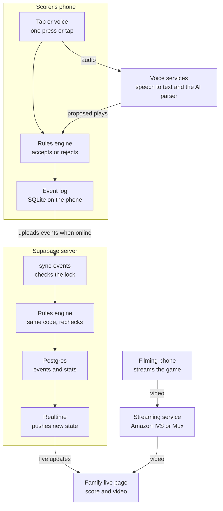
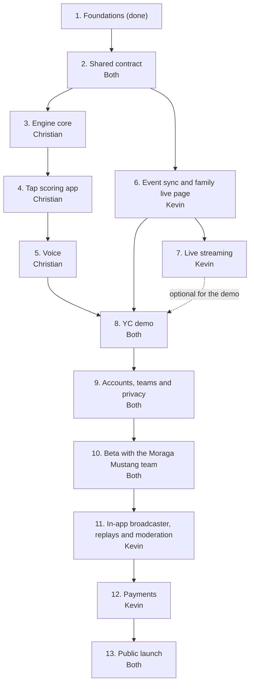

# Youth baseball and softball scoring app: engineering plan

Last updated October 22, 2026. Christian Alcala.

Sandlot is a GameChanger competitor for baseball and softball that wins on scoring. A parent scores by voice or one tap, fixes any mistake in one step, and keeps scoring with no signal, while family follow the score and the video live. This plan orders the work by dependency, not by date. Christian and Kevin build two tracks side by side, which meet at the YC demo and then grow into the beta and the public launch.

## Team and ownership

Two people build Sandlot, each directing their own coding agents. Each person owns separate directories, so their agents rarely touch the same files.

| Person | Owns | Directories |
| --- | --- | --- |
| Christian, with Claude Code and Codex | Rules engine, tap scoring app, voice | `packages/engine`, `packages/voice`, `apps/mobile` |
| Kevin, with Claude Code and Codex | Supabase backend, event sync, the family live page, live streaming | `supabase/`, `apps/web` |

- **Shared contract.** The engine's `Event` type, the events table's columns, and the app's upload function. Both people agree on these before the tracks split, and both sign off on any later change.
- **Root files.** Only one person at a time changes root config or `pnpm-lock.yaml`.
- **Agents.** Both people use Claude Code and Codex for now. In each person's track, Claude Code orchestrates and writes most of the code, and Codex takes tasks Claude Code hands it. Every agent reads `AGENTS.md`, works in its own git worktree, and opens PRs. Only people merge.

## Goal

A team switches only when scoring gets clearly easier for the scorekeeper and the families following along lose nothing. So the first version matches GameChanger on what families see and beats it on what the scorekeeper does.

| Capability | First version | Later |
| --- | --- | --- |
| Pitch-by-pitch scoring, baseball and softball | Taps for pitches, voice or taps for plays | |
| Fixing mistakes | Undo, spoken fixes, and a play log that previews what a fix changes | Parents flag a play they think is wrong |
| Scoring with no signal | A whole game offline, synced afterward | |
| Live score and play-by-play for family | A private web link, with no app to install | Public game pages |
| Live video | A second phone streams through a hosted service, shown on the family live page | Our own in-app broadcaster, replays and highlights |
| Box scores and season stats | Yes | Spray charts, more stats |
| Pitch-count report for the league | Yes | |
| Roster, lineups, handing scoring to another parent | Yes | |
| Team schedule | Yes | |
| Team messaging | Not planned | |
| Paid tier | Not in the first version | After parents show they like the app |

GameChanger has no public API, so nothing can be written into it ([Dugout](https://www.getdugout.com/gamechanger-api), [gcstats](https://gcstats.app/gamechanger-api/)). A team's official stats live in whichever app it scores in. GameChanger is Little League's official partner, so the first customers are teams not tied to it, like travel teams, PONY leagues and rec leagues. The Moraga beta runs alongside GameChanger and stays unofficial.

## Architecture at a glance



Only the scorer's phone writes events. The server runs the same engine on every event, and the family live page only reads the result. Video goes from a filming phone through the streaming service, never through Supabase.

## Data model

A game is an append-only list of events, and the current game is that list replayed through the engine. Every other part of the app, from the diamond on screen to the box score, reads that one shape. The full types live in `packages/engine/src/types.ts`.

```ts
type Sport = 'baseball' | 'fastpitch' | 'slowpitch';

type Command =
  | { kind: 'pitch'; result: 'ball' | 'called_strike' | 'swinging_strike' | 'foul' | 'foul_tip' | 'hit_by_pitch' | 'in_play' }
  | { kind: 'ball_in_play'; outcome: Outcome; trajectory?: Trajectory; fielders: Position[]; advances: Advance[] }
  | { kind: 'runner'; event: RunnerEvent; runner: PlayerRef; to: Base | 'out' }
  | { kind: 'substitution'; change: Substitution }
  | { kind: 'game'; event: GameControl }
  | { kind: 'undo'; target: GroupId }
  | { kind: 'correct'; target: GroupId; replacement: Command[] };

type Event = {
  id: EventId;        // made on the phone, so resending is harmless
  gameId: GameId;
  seq: number;        // order within the game
  group: GroupId;     // one voice press or one tap action
  lockEpoch: number;  // which scorer session wrote it
  source: 'tap' | 'voice';
  command: Command;
};

type RuleSet = { sport: Sport; innings: number; fielders: 9 | 10; /* every rule is a setting */ };

type GameState = {
  inning: number; half: 'top' | 'bottom'; outs: 0 | 1 | 2;
  count: { balls: number; strikes: number };
  bases: { 1?: Runner; 2?: Runner; 3?: Runner };
  score: { home: number; away: number };
  lineups: Lineups; defense: Defense; pitchCounts: Record<PlayerId, number>; alerts: Alert[];
};
```

- Events are never edited or deleted. Undo and fixes are new events that target a group, so one undo reverses everything one press recorded.
- Game state is always computed from the events. The stored copy on the server is a cache that can be rebuilt.
- Events and stats refer to players by ID. Names live in one table, which keeps privacy rules in one place.
- IDs are branded types, so an event ID can never be passed where a group ID belongs.
- Sport is part of the rule set from day one. Adding softball later, after these types are fixed, would mean rewriting the engine.

## Rules engine

The engine is the critical path. Voice, stats, corrections and the family view all depend on it being right. It is pure TypeScript with no network, clock or randomness, so the same events always give the same game, on the phone and on the server.

| Function | What it does |
| --- | --- |
| `apply`, `applyGroup` | Accept or reject one command, or a whole press, all or nothing |
| `replay` | Build the game from its events |
| `candidates` | List every legal reading of an unclear play, such as "runner scores" with two runners on |
| `classify` | Decide whether a play saves instantly, needs a confirm, or needs a hit-or-error call |
| `explain` | Say a play in plain words for the read-back banner |
| `previewCorrection` | Show what a fix changes: score, stats, and later plays it changes or breaks |
| `missedPlayCandidates` | Suggest the missed play that would make a rejected play legal |
| `stats` | Box score and pitching lines from the replayed game |

**Baseball and softball.** Each league's rules are a rule set, which is data. A preset like Little League Minors is a published rule set, and a local league's rules are a preset plus overrides. The September plan's settings already cover innings, fielders, batting order, walks, stealing, leadoffs, dropped third strikes, run limits, mercy rules and pitch counts. Softball adds settings, such as slowpitch rules that start the count at one ball and one strike or call the batter out on a foul with two strikes. Check each against the league's rule book before writing the fixture.

**Presets ship only when a real team can prove them.** The beta team plays in Moraga's Mustang division, which follows PONY rules with local changes. So Mustang with Moraga's rules comes first, then Pinto. Softball presets ship when a softball team joins the beta.

**Testing.**

- Fixtures written first. Each is a YAML file with a starting state, commands, the expected result, and a citation to the rule book.
- Property tests. Outs stay between 0 and 2, no base holds two runners, replaying equals applying one by one, and undo restores the prior state.
- Real games. Paper scorebooks and beta games are entered as event lists, and the engine's box score must match exactly.

### Moraga rules

The first presets are Moraga's Mustang and Pinto divisions, which use PONY rules with local changes ([Moraga PONY rules](https://www.moragabaseball.org/pony-rules/), Mustang revised February 2024, Pinto revised April 2025). Settings marked new are ones the September plan didn't have.

| Rule | Mustang, ages 9 and 10 | Pinto, ages 7 and 8 | Engine setting |
| --- | --- | --- | --- |
| Pitcher | Kids pitch | Coaches pitch to their own team | Pitch source |
| Fielders | 9 | 10, with a roving outfielder | Fielders |
| Time limit | 6 innings, but no new inning after 2 hours from the umpire's start time. If tied, one extra inning, then a tie. | Same, except a tie after 6 innings can go up to 3 more innings inside the 2 hours | Time limit. New: tie rules. |
| Called game | Complete after 4 innings, or 3 and a fraction if the home team leads | Not stated | New: length of a complete game |
| Run limit | None | 5 runs in each of innings 1 to 5 | Run limit with a late-inning exception |
| Pitches per batter | No limit | 6. The batter is out after the 6th unless it's fouled off. | Max pitches per batter |
| Strikeouts | Called or swinging. The catcher doesn't need to catch the third strike. | Swinging only | Dropped third strike off. New: called strikes off. |
| Walks and hit batters | Walks allowed. Hit batters follow the PONY rule book. | None | Walks and hit-by-pitch |
| Stealing | First half: only after the ball crosses the plate, no leadoffs. Second half: leadoffs and steals if most coaches agreed. | None. A runner leaving early gets one team warning, then is out. | Stealing and leadoffs, pinned per game. New: out for leaving early. |
| Bunting | Not allowed | Not allowed | New: the engine rejects bunts |
| Infield fly and balks | Neither | No infield fly | Off |
| Batting order | Everyone present bats. A late arrival joins at the end. | Everyone present bats. Batting out of order costs one out, and plays from the wrong batter on are wiped out. | Continuous order. New: a late-arrival command and an out-of-order penalty. |
| Pitching limits | Pitch Smart counts for ages 9 and 10. At most 6 outs a day in the first half and 9 in the second, across every game that day. A removed pitcher can't pitch again that game. | None | Pitch-count table. New: an outs-per-day limit and no pitcher re-entry. |
| Playing time | Every player plays 4 defensive innings | Players sit out in rotation when one team has more players | New: playing-time alerts |
| Thrown bat | Out on the second time | Out on the second time, scored like a strikeout with no runners advancing | New: batter out by rule |
| Official scorer and reporting | The home team's scorekeeper is the official scorer. Teams report scores and pitch counts to the commissioner. | Not stated | A pitch-count report from the app |

- The engine never reads a clock. It times the 2-hour limit from the umpire's start time, which the scorer enters, and from the timestamps on events.
- The outs-per-day limit spans games. The app adds up a pitcher's outs from earlier games that day and passes them into the new game's setup.
- The rules change halfway through the Mustang season. Each game pins its own rule set, so first-half games keep replaying under first-half rules.
- Pinto's dead-ball rule at the pitcher's circle needs no engine logic. The scorer records where the runners end up.
- Pinto's out-of-order penalty wipes out later plays. That is a correction like any other: one event that removes the wrong batter's plays and adds the out.

## Phone app and offline scoring

The scorer's phone is the source of truth during a game, so scoring never waits on the network. The app is Expo with TypeScript, and it keeps the game in SQLite on the phone.

- **Saving a play.** The engine accepts the command, one SQLite transaction writes the event and queues it for upload, then the screen updates. Nothing waits on the network.
- **One scorer at a time.** A game has one scorer lock. Only the lock holder writes events, so two phones never need their edits merged. Taking the lock needs signal. Keeping it does not.
- **Handing off.** The scorer hands the lock to another parent while online with nothing left to upload. An admin can force a takeover, and late events from the old phone come back as items to review.
- **Sync.** The phone uploads queued events when signal returns, when the app opens, every few seconds during a live game, and before the game is finalized. Each event has its own ID, so a retry never duplicates a play.
- **The screen.** The diamond, count, score and play log all come from the replayed game. Pitches are one tap on a bar that is always visible. A play is one tap on the outcome, or one voice press.
- **Corrections.** Undo is instant. Every other fix opens a preview of what it changes before it saves. The voice spec from September defines these flows, and it carries over.

The September plan wanted SQLite encryption on the phone because it holds kids' names. Confirm Expo supports it before relying on it.

## Voice scoring

Voice is the main reason a team would switch, and also the biggest unknown, so a throwaway prototype tests it before the app depends on it. The rule from September stays: the AI proposes a play, and only the engine decides whether it is legal.

1. The scorer holds the mic button. The phone records immediately, before any connection opens, so no words are lost.
2. Speech goes to a transcription service. September's plan chose OpenAI's gpt-live-transcribe, and the prototype confirms that choice or replaces it.
3. A small parser on the phone handles common phrases like "ball", "steals second" or "fly out to center" with no AI. Anything else goes to an AI parser, which returns candidate commands.
4. The engine checks the commands and classifies the play. A simple legal play saves instantly, with a spoken-word banner and undo. An unclear, complex or misheard play shows a confirm card or buttons.
5. Any failure falls back to tap scoring in one step.

Taps record pitches and voice records plays. That split keeps voice cheap, at about 4 cents a game by September's estimate, and puts voice where it saves the most taps.

**What the prototype must prove.** Record 100 or more spoken plays over game video with crowd noise playing. Voice goes ahead only if all of these hold:

- [ ] At least 95% of plays parse exactly right
- [ ] No wrong play would have saved without a confirm
- [ ] 90% of simple plays show a result within 1.5 seconds of release
- [ ] 90% of complex plays show a result within 2.5 seconds
- [ ] Measured cost per game is under 25 cents

The prototype is thrown away. Its recorded test set and the on-phone phrase parser carry into the real app. September's voice edge-case spec carries over unchanged, apart from deferring parent flags.

The first version records the whole press, then uploads the clip for transcription. It is simpler to build and test, and it runs in Expo Go. Streaming transcription, which shows words while the scorer speaks, comes before the beta.

## Server

Supabase stores every event, checks each one again with the same engine, and pushes the live game to family members. It also handles accounts, teams and privacy rules. It keeps September's design for these parts. Video runs through a hosted service for now, and payments wait.

| Part | First version |
| --- | --- |
| Accounts and teams | Profiles, teams, seasons, and roles for admin, scorekeeper, parent and fan. Accounts are adults only. |
| Players | Names live only in the players table. Roster entries hold jersey numbers. Parents claim their child. Opponents are jersey numbers only. |
| Games | The schedule of games with date, time and field, then events, a cached game state, scorer locks, review flags, and per-game stats |
| `sync-events` | Checks the scorer lock and event order, runs the engine, stores accepted events, flags rejected ones, recomputes stats, and broadcasts the new state |
| `voice-session`, `voice-parse` | Checks the lock and the team's monthly voice limit, starts a transcription session, and runs the AI parser |
| Invites and claims | Parents and fans join by invite. A parent claims their child's roster entry. |
| Live view | Supabase Realtime sends each new game state to team members. Messages carry IDs and state, never names. |
| Privacy | Row-level security on every table, with database tests. In-app deletion of a child or an account. Voice transcripts deleted after 30 days. |
| Family live page | A web page in `apps/web` on a private link. It shows the live score and play-by-play from Realtime, and the video when a stream is running. Kevin owns it. |
| Live streaming | A hosted service, Amazon IVS or Mux, takes the stream from a second phone. The live page plays it and draws the score from the game's events. Kevin owns it. |

The server always wins. If its game state differs from the phone's, the phone takes the server's version and shows "Game re-synced". The table for who sees which name, and public game pages, wait until public pages ship.

## Milestones

Milestones follow dependencies, not dates. Each one ends in a check that has to pass before anything built on it starts. Christian's and Kevin's tracks run side by side and meet at the YC demo.



| # | Milestone | Owner | Includes | Done when |
| --- | --- | --- | --- | --- |
| 1 | Foundations | Christian | Repo, CI, engine package, Expo app | Done. CI passes, and the app runs on an iPhone and the Android emulator. |
| 2 | Shared contract | Both | `Event` type, events table, upload function | Kevin's backend stores an event the engine produced |
| 3 | Engine core | Christian | Mustang rules for pitches, walks, strikeouts, balls in play with runner advances, steals, inning changes, score, undo and box score. The interface freezes early so voice and sync can build on it. | Fixtures pass, and one real game replays to the right box score |
| 4 | Tap scoring app | Christian | Lineup setup, diamond, pitch bar, play outcomes, play log, undo, games saved on the phone | A full game scored by tap from video, in airplane mode |
| 5 | Voice | Christian | Hold to talk, recorded clip sent for transcription, AI parser, engine check, confirm card | Meets the five targets in Voice scoring |
| 6 | Event sync and family live page | Kevin | Events uploaded to Supabase, live score on a private web link | A second device sees each play within a few seconds |
| 7 | Live streaming | Kevin | A second phone streams through an existing app to a hosted service. The live page plays it with the score drawn on top. The demo uses footage that needs no consent. | Video plays on the live page with a correct score overlay |
| 8 | YC demo | Both | One recorded game scored and streamed end to end, the demo video, the application | Application submitted |
| 9 | Accounts, teams and privacy | Both | Sign in with Apple and Google, invite links, parent claims, row-level security, deletion | Database tests pass for every visibility rule, and a parent claims and deletes a test child |
| 10 | Beta with the Moraga Mustang team | Both | Apple developer account, TestFlight, streaming transcription for voice, weekly releases | Six games in a row match GameChanger's box scores, with zero data loss |
| 11 | In-app broadcaster, replays and moderation | Kevin | Development build with a streaming module, media consent, replays, highlights, report and stop-stream tools | A full game streamed from the app, with replay and highlights |
| 12 | Payments | Kevin | Paid tier through the app stores | Sandbox purchases work on both stores |
| 13 | Public launch | Both | Pinto, softball and Little League presets, store listings, load test | Store review approves |

Milestone 7 is optional for the demo. If streaming isn't ready, the demo shows the live score page without video and nothing else changes.

## Changes from the September plan

The architecture stays. What changes is the order of work, so the riskiest parts get tested first and the scoring app is proven before the backend is built around it.

| Area | September plan | This plan | Why |
| --- | --- | --- | --- |
| Engine, event log, scorer lock, AI proposes and engine decides | As designed | Kept | These are the right foundations |
| Voice edge-case spec | Full spec | Kept, with parent flags deferred | It is thorough and still fits |
| Order of work | Backend, privacy and presets before any game is scored, voice after | Engine, tap app and voice first. Accounts and privacy after the YC demo. | Proves the scoring experience first |
| Voice transcription | Streaming from the first version | A recorded clip first, streaming before the beta | Simpler to build and test, and it runs in Expo Go |
| Who builds | Codex writes all the code | Christian and Kevin, each with Claude Code and Codex | Two people with separate directories |
| Sports | Baseball presets | Baseball and softball in the rule data from day one. Softball presets ship with a softball beta team. | Adding a sport after the types are fixed means a rewrite |
| Beta presets | Little League Minors and Majors | Moraga Mustang, then Pinto, both PONY | The beta team plays Mustang |
| Live video | Our own broadcaster module before launch | A second phone through a hosted service first. Our own broadcaster after the beta. | No native module or developer account needed for the demo |
| Family view | In the app, for team members | A private web link, with no app to install | Family follow along without installing anything |
| Payments | Before the public launch | After parents show they like the app | Prove the product first |
| Schedule | Fixed dates for every milestone | Ordered by dependency, with a check ending each milestone | The plan stays true when dates move |

## Risks and open questions

The biggest risk is voice failing the prototype, because voice is the main reason to switch. Each risk below has a planned response.

| Risk | What happens | Response |
| --- | --- | --- |
| Voice misses its targets | The main reason to switch gets weaker | Ship tap-first, with outcomes in one tap. Keep voice as a beta experiment and retest with the next transcription model. |
| Leagues require GameChanger | Slower adoption | Start with travel teams, PONY leagues and rec leagues. |
| A local rule the engine doesn't know | Wrong box scores | Add a rule setting and a fixture. The beta comparison against GameChanger catches these. |
| Two people's agents editing the same files | Conflicts and broken builds | Separate directories, one owner for root files at a time, and the shared contract agreed before the tracks split |
| Many agent PRs waiting for review | Slow merges | CI must pass, fixtures come first, PRs stay small, and each person reviews the other's work |
| Streaming children without consent | Legal and trust problems | The demo streams footage that needs no consent. Media consent and moderation ship with the in-app broadcaster. |
| Saturday-morning traffic peaks | Voice, live updates or streams fail at the busiest time | Load test before launch. OpenAI, Supabase and streaming limits per plan are unverified. |
| Children's privacy law | Required changes late in the project | Adults-only accounts, names in one table, and an attorney review before the public launch |

**Decisions.**

- **Beta division.** Mustang in Moraga, which uses PONY rules with local changes.
- **Team.** Christian owns the engine, tap scoring app and voice. Kevin owns Supabase, event sync, the family live page and streaming.
- **Who writes the code.** Christian and Kevin both use Claude Code and Codex for now. Claude Code orchestrates each track and writes most of the code. Codex takes implementation tasks Claude Code hands it. Every agent follows `AGENTS.md`.
- **Schedule and messaging.** The app has a team schedule. It has no messaging.
- **GameChanger.** No partnership approach is planned.
- **Email.** None in the first version. Parents sign in with Apple or Google, and invites are links a parent texts from the phone's share sheet. Add an email service such as Resend only if parents ask for email sign-in.
- **Developer programs.** The Apple and Google programs wait until the beta needs them. The demo runs in Expo Go.

**Open questions.**

- [ ] Did the Mustang coaches vote to allow leadoffs and steals in the second half this season?
- [ ] Can Christian and Kevin each merge the other's PRs after reviewing them? `AGENTS.md` now says only Christian merges.
- [ ] Which hosted streaming service, Amazon IVS or Mux? Kevin decides with a short test.

## Sources

- The September implementation plan (v1.4) and voice edge-case spec (v1), which this plan revises
- [Dugout: GameChanger API, does it exist?](https://www.getdugout.com/gamechanger-api)
- [gcstats: GameChanger API](https://gcstats.app/gamechanger-api/)
- [GameChanger: new scoring experience for baseball and softball](https://www.gc.com/post/new-scoring-experience-for-gamechanger-baseball-softball)
- [GameChanger help: pitch tracking settings](https://help.gc.com/hc/en-us/articles/19216166101261)
- [Filterjoe: review of GameChanger for youth baseball](https://www.filterjoe.com/?p=3322)

The GameChanger facts come from search results and these pages' summaries. They were not checked against GameChanger's current app.
