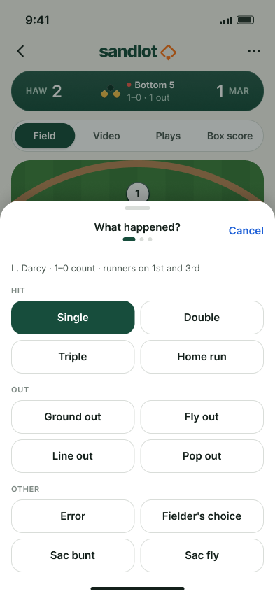
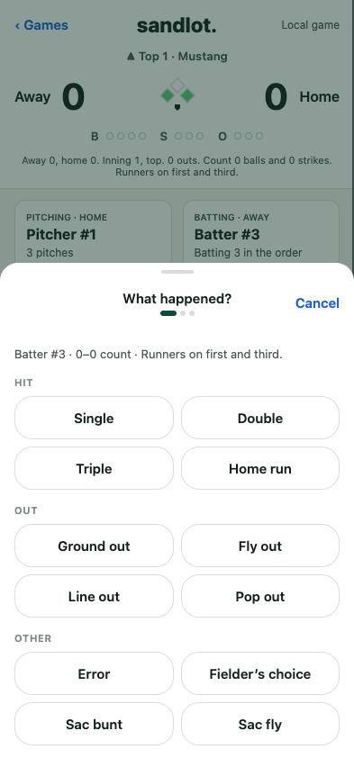
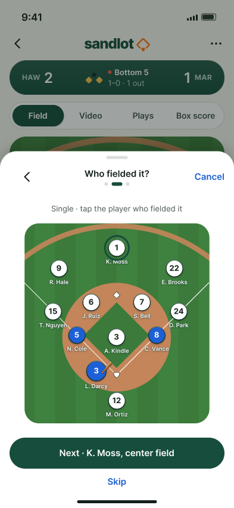
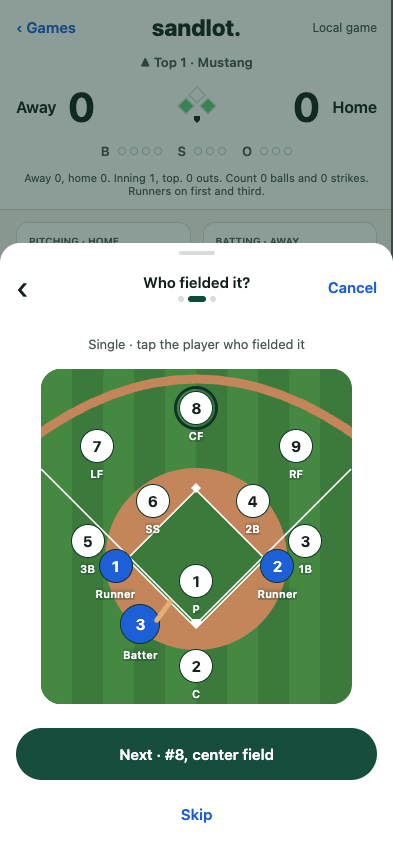
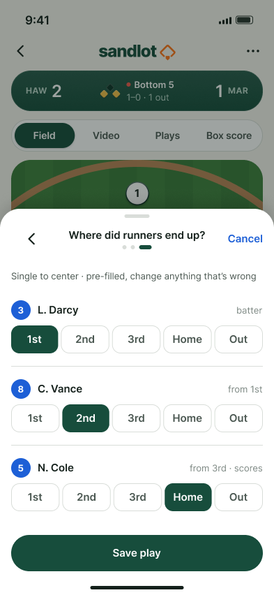
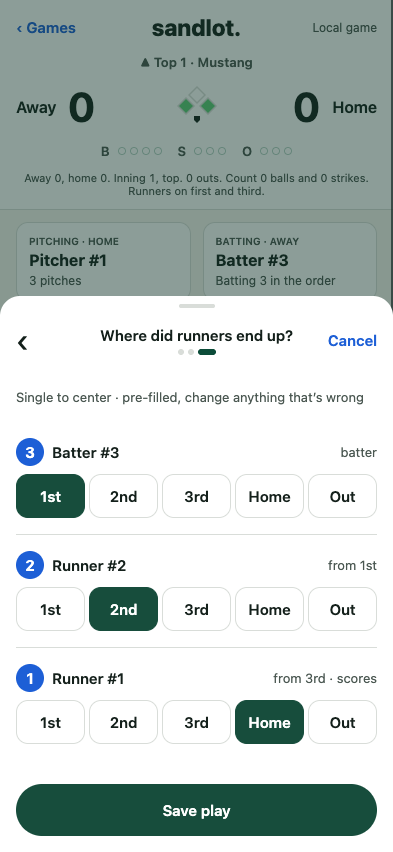
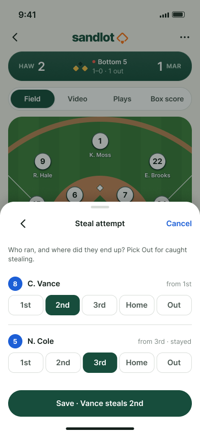
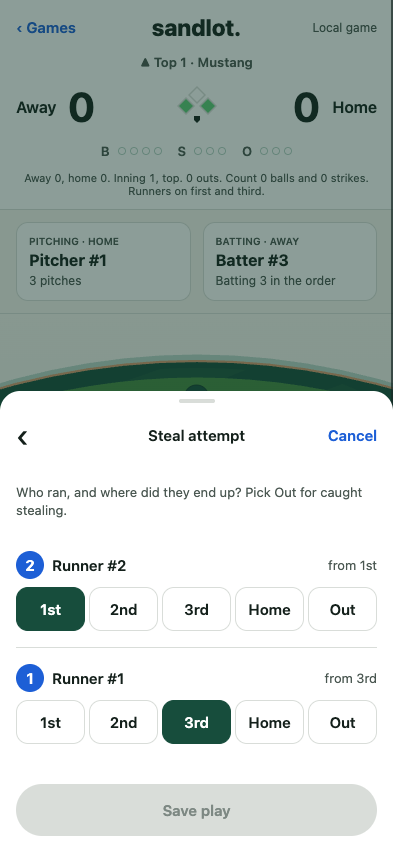
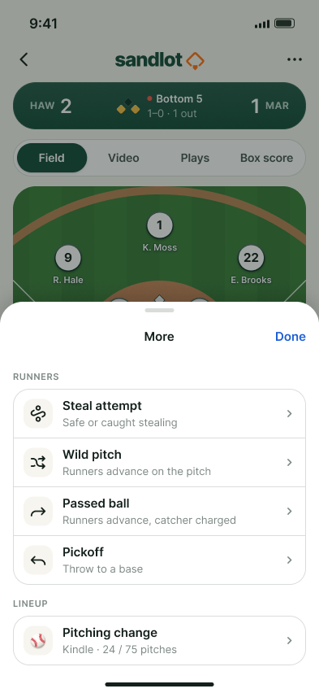
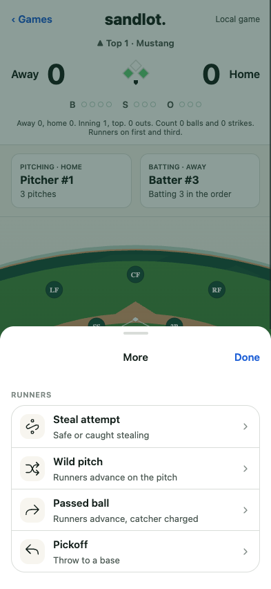

# Ticket 27 web comparison

The live images come from the actual 393 × 852 web build, the public scoring controls, Expo SQLite and the real engine. The browser establishes both runners through saved hits. It does not inject game state. The scorer underneath the sheets is the existing26 screen; its redesign belongs to38. The demo has numbered players, so the sheets display batter/runner numbers and fielding positions rather than fabricated names.

| Figma frame | Live web build |
| --- | --- |
|  |  |
|  |  |
|  |  |
|  |  |
|  |  |

Reproduce from the repository root:

```sh
pnpm --filter @sandlot/mobile exec expo export --platform web --dev --output-dir dist-web
cd apps/mobile
SANDLOT_SCREENSHOTS_DIR="$PWD/../../docs/verification/27/web" node --test test/scorer-gallery.web.test.mjs
```

The test serves COOP/COEP headers and the WebAssembly MIME type, drives the real browser, verifies storage after a fresh page reload, and fails on runtime errors. Pitch-limit near and at-limit alerts are tested against real SQLite and the engine. The browser also checks near-limit display and undo. The native flow covers hits, chosen runners, all four More actions, force versus tag evidence, connected Expo Go reopening and whole-play undo. It does not repeat sixty native fouls for the threshold.
