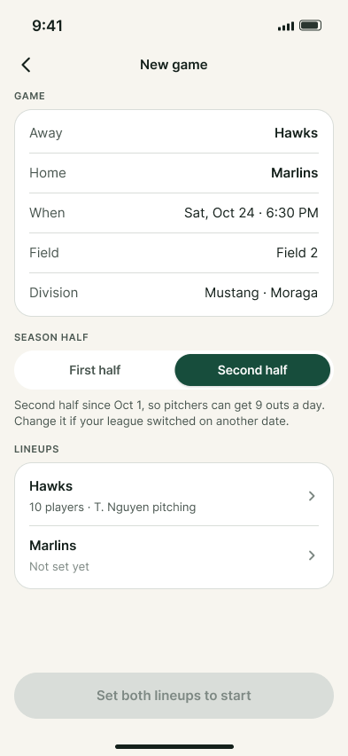
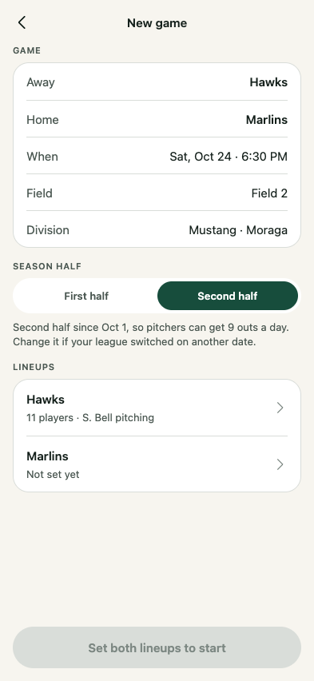
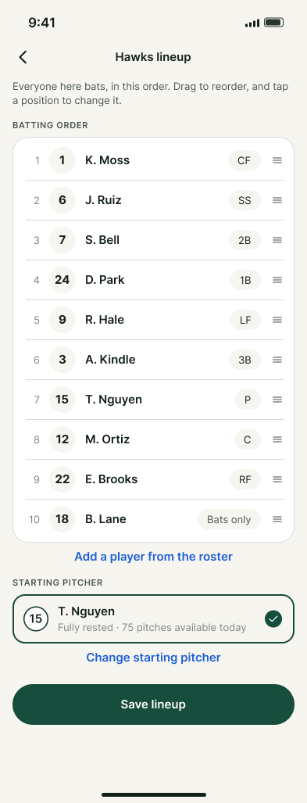
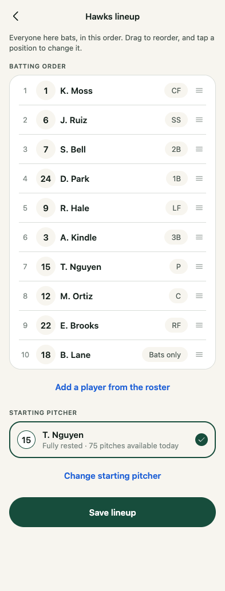
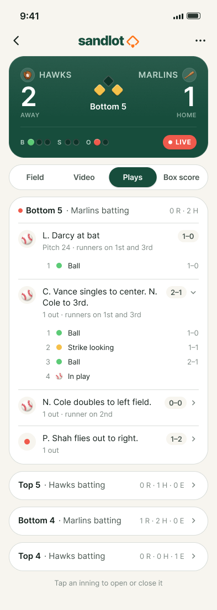
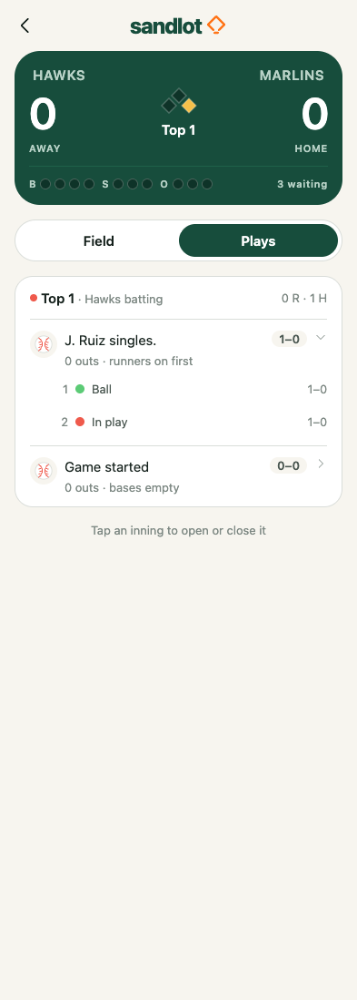

Needs Christian: Hit by pitch has no Figma design

# Ticket 28 provisional web evidence

These captures show the functional candidate at 393 px wide. They are not a Figma parity pass. The live Figma connection was read for nodes `167:11241`, `168:11244` and `69:1895`, including component descriptions and asset instructions. The exact connection renders are included below. They are verification references, never application assets.

| Live Figma reference | Actual web candidate |
| --- | --- |
|  |  |
|  |  |
|  |  |

The browser uses the real engine and Expo SQLite. It selects both lineups through public controls, removes and restores the pitcher assignment, drags a player, swaps a position, adds a roster player as Bats only, changes both starting pitchers, starts the book, scores and undoes a whole play. It checks actual visible batter and pitcher identities after reopening. No game state is injected.

`game-setup-empty.png`, `lineup-rejected.png`, `configured-scorer.png` and `plays-undone.png` capture other states on that path. The longer Lineup and Plays captures use a 393 px viewport at their reference heights of 1027 and 1098 px. The web capture has no OS status bar. These facts do not exempt other element or spacing differences from the current review gate.

The edited game uses eleven away players, S. Bell as the away pitcher and N. Cole as the home pitcher. Its history differs from the Figma sample. The screenshots preserve the real selected data rather than fabricating a book to resemble the image.

## Known stops and differences

The candidate changes Games, Setup, Lineup, Plays, Field identities and navigation, the three In play steps and the runner sheet. Each touched screen still needs its committed Mac/Figma pair and independent live-frame comparison. The Field path retains Hit by pitch to preserve existing scoring behavior and tests. The user explicitly says that control has no Figma design. Work stopped under the updated implementation-loop contract.

No parity corrections were made after the stop. The candidate still has approximated static artwork instead of the live response's exact local assets. Other known differences include the navigation height, card and row spacing, bench-player radio treatment, missing scoreboard role badges, four/three/three count dots instead of three/two/two, pitch marks and some history wording. This is a preliminary list, not a completed element-by-element review. The parent will commit phone pairs that show the differences.

## Check result

The standalone full browser path passed after active-route selection was corrected. Two later full `pnpm verify` runs each passed 54 of 55 mobile tests and failed this new browser path at its final fresh navigation to Games. The actual screen entered the storage-blocked state. See [the failure evidence](../browser-failure/README.md). No app correction or verifier workaround was applied after the design stop.

Reproduce from the repository root:

```sh
SANDLOT_SETUP_SCREENSHOTS_DIR="$PWD/docs/verification/28/web" pnpm verify
```

The setup-specific variable keeps the older gallery test's ticket 27 captures out of this directory. The parent owns the still-unrun functional Mac recipe, live-frame screenshot pairs and fresh independent review.
